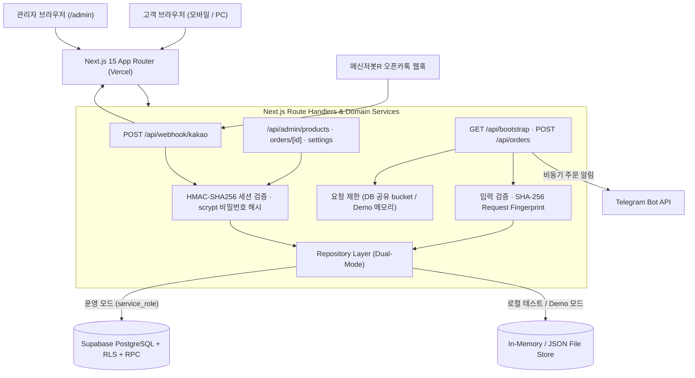
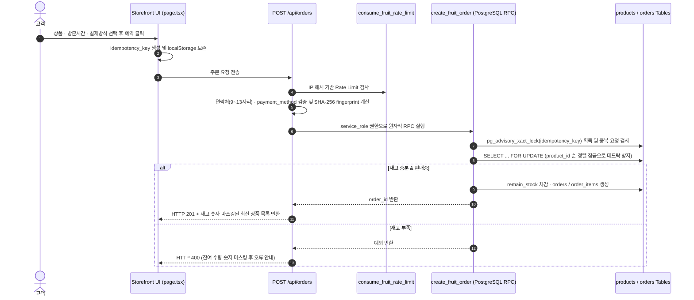
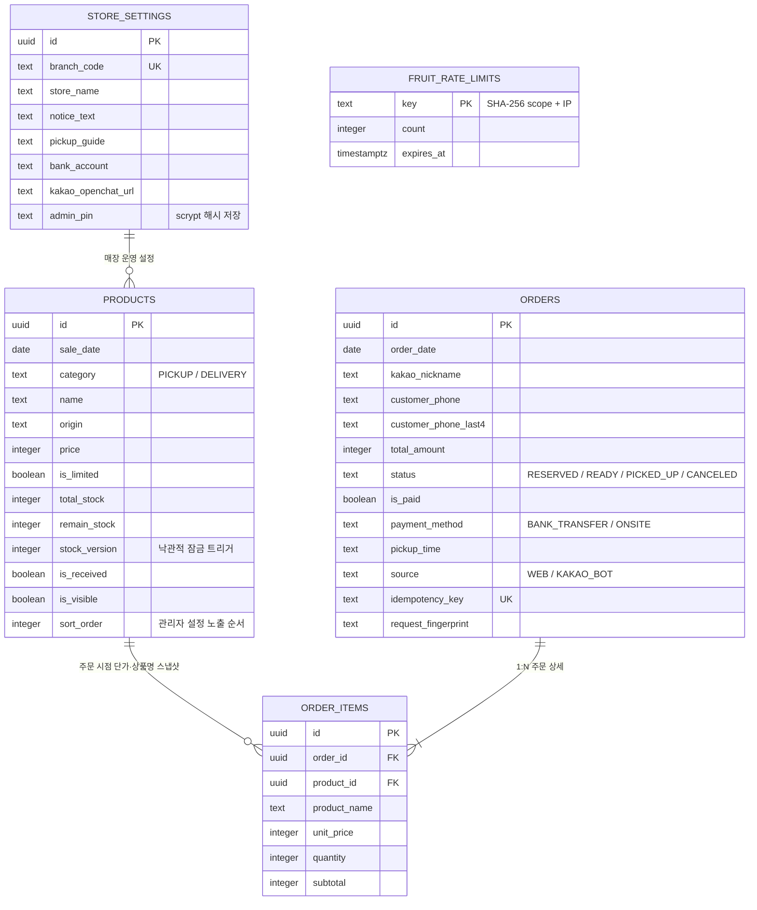

# 🍎 후르츠파머 유천점 (Fruit Order Platform)

> 오픈카톡 공동구매·매장 픽업 예약의 수기 주문 누락, 재고 불일치, 정산 혼선을 해결하기 위해 설계·배포한 **실운영 과일 예약·재고·주문 집계 플랫폼**

- **Production URL**: https://fruit-order-platform.vercel.app
- **Tech Stack**: Next.js 15 (App Router), React 19, TypeScript, Tailwind CSS 4, Supabase (PostgreSQL + RLS + PL/pgSQL RPC), Vercel

---

## 1. 프로젝트 배경 및 해결한 문제

동네 과일 매장에서는 매일 새벽 경매 상품을 카카오톡 오픈채팅방에 공지하고 댓글로 주문을 받아왔습니다. 기존 방식에는 4가지 운영 병목이 있었습니다.

1. **수기 집계 오류 및 재고 초과 판매**: 단톡방 댓글을 수동으로 합산하는 과정에서 한정 수량 상품이 초과 예약됨
2. **결제·방문 시간 확인 반복 문의**: 계좌입금 예정 고객과 현장결제 고객, 오전/오후 방문 고객을 구분하기 어려움
3. **개인정보 및 재고 민감정보 노출**: 단톡방 내 연락처 노출 위험 및 고객 화면에 정확한 잔여 수량이 노출되는 문제
4. **모바일 환경 관리 어려움**: 매장에서 사장님이 스마트폰만으로 빠르게 품절/입고/노출 순서를 바꾸기 어려움

이를 해결하기 위해 **고객용 초간단 픽업 예약 웹앱(`/`, `/orders`)**, **사장님 전용 모바일 어드민(`/admin`)**, **오픈카톡 자동 파싱 웹훅(`/api/webhook/kakao`)**, **DB 원자적 재고 차감 RPC**를 통합 구현했습니다.

---

## 2. 핵심 기능

### 손님용 스토어프론트 (`/`, `/orders`)
- **원클릭 예약 & 장바구니**: 단품 바로 예약 및 다품목 장바구니(`localStorage` 최신 상품명·가격·품절 상태 자동 동기화)
- **방문 예정 시간 & 결제 방식 선택**:
  - 방문 시간 프리셋(`오전 09~12시`, `오후 12~19시`, `내일 방문`, `직접 입력`)
  - 결제 방식(`🏦 계좌입금` + 계좌번호 원클릭 복사 / `💳 현장결제`)
- **오픈카톡 연동 주문서 자동 복사**: 주문 접수 직후 닉네임·품목·결제방식·픽업예정시간이 포맷된 주문서를 클립보드에 자동 복사
- **공개 재고 숫자 비노출**: 손님 UI 및 공개 API(`/api/bootstrap`, `POST /api/orders`)에서는 `remain_stock` / `total_stock` 원시 숫자를 숨기고 `구매가능` / `품절` 상태만 제공
- **한글 초성 검색 & 내 예약 조회**: `ㅅㅎㄸㄱ` 등 초성 검색 지원 및 닉네임+연락처 기반 예약·입고·결제 확인 조회

### 관리자 콘솔 (`/admin`)
- **판매 대시보드**: 기간별/오늘 매출, 미결제·입고·수령 대기 현황 카드, 품목별 주문 합계 요약표
- **주문 현황 & 원터치 처리**: `[계좌입금/입금대기]` · `[현장결제/방문결제 대기]` 구분 뱃지, 결제확인/입고완료/수령완료/취소(재고 자동 복구), 초성/전화번호 검색, CSV 다운로드(CSV 수식 인젝션 방어)
- **상품·재고 & 노출 순서 관리**: 빠른 프리셋 + 상품명/산지 분리 입력, 스마트폰 사진 WebP 자동 압축 업로드, 재고 증감(`+1`/`-1`/`품절`), **상품 노출 순서(`sort_order`) 맨 위로/위/아래 즉시 변경**, 오픈카톡 공지 문구 자동 생성
- **텔레그램 실시간 알림 & 카톡 봇 웹훅**: 웹 주문 발생 시 텔레그램 알림 발송 및 메신저봇R 텍스트 주문 자동 파싱 접수

---

## 3. 시스템 아키텍처



---

## 4. 동시성 제어 및 주문 보안 흐름



---

## 5. 데이터베이스 ER 다이어그램



---

## 6. 보안 및 안정성 설계 포인트

| 영역 | 적용된 기술 및 설계 |
| --- | --- |
| **DB 동시성 및 재고 무결성** | `SELECT ... FOR UPDATE` 행 잠금 시 `product_id` 오름차순 정렬로 데드락 방지, `bump_fruit_stock_version()` 트리거 기반 낙관적 잠금으로 관리자 동시 재고 편집 충돌 차단 |
| **중복 결제·접수 방지 (Idempotency)** | `pg_advisory_xact_lock` + `idempotency_key` + 요청 필드 전체 SHA-256 `request_fingerprint` 비교로 네트워크 재시도는 멱등 처리하고 내용 변조 시 차단 |
| **접근 제어 (RLS & Zero-Trust)** | 5개 전체 테이블 RLS 활성화 및 `anon`/`authenticated` 직접 접근 전면 차단, 서버(`SUPABASE_SERVICE_ROLE_KEY`)에서만 `service_role` 전용 RPC 실행 |
| **관리자 인증 & 비밀번호** | `scrypt` 솔트 해시 저장(레거시 평문 로그인 시 안전 마이그레이션), `ADMIN_SESSION_SECRET` 기반 HMAC-SHA256 서명 쿠키 및 비밀번호 변경 시 기존 세션 전체 무효화(`credentialVersion`) |
| **민감정보·재고 비노출** | 비관리자 `/api/bootstrap` · `/api/orders` 응답에서 `admin_pin`, 타인 연락처/배송지/내부 메모, `remain_stock`/`total_stock` 원시 숫자 및 재고 부족 에러 내 잔여 개수 마스킹 |
| **서버리스 공유 Rate Limit** | 로그인(8회/10분)·고객 조회(30회/10분)·웹 주문(30회/10분)을 Supabase `consume_fruit_rate_limit` RPC로 서버 인스턴스 간 공유 적용 |

---

## 7. 디렉토리 구조

```text
fruit-order-platform/
├── src/
│   ├── app/
│   │   ├── page.tsx                         # 고객 스토어프론트 (상품 목록, 장바구니, 예약 모달)
│   │   ├── orders/page.tsx                  # 고객 구매 및 예약 상세 조회
│   │   ├── admin/page.tsx                   # 관리자 대시보드/주문/상품/설정 컨테이너
│   │   └── api/
│   │       ├── bootstrap/route.ts           # 초기 데이터 로드 (공개/관리자 응답 분리)
│   │       ├── orders/route.ts              # 고객 주문 생성 및 예약 조회
│   │       ├── webhook/kakao/route.ts       # 오픈카톡 봇 텍스트 주문 자동 파싱 웹훅
│   │       └── admin/
│   │           ├── products/route.ts        # 상품 등록·수정·재고조정·노출순서 변경·삭제
│   │           ├── orders/[id]/route.ts     # 관리자 주문 상태·입금확인 변경
│   │           └── settings/route.ts        # 매장 설정 변경·관리자 로그인·비밀번호 변경
│   ├── components/
│   │   ├── SafeImage.tsx
│   │   └── admin/                           # AdminDashboardTab · AdminOrdersTab · AdminProductsTab · AdminSettingsTab
│   ├── lib/
│   │   ├── repository.ts                    # Supabase / Demo 자동 분기 (운영환경 DB 미설정 차단)
│   │   ├── supabase-store.ts                # Supabase RPC · 페이지네이션(1,000건 초과 대응) 구현
│   │   ├── store.ts                         # 로컬/테스트용 Demo Store
│   │   ├── store-helpers.ts                 # 공개 응답 마스킹(재고/개인정보) · 집계 · 필터 헬퍼
│   │   ├── admin-auth.ts                    # HMAC 세션 토큰 생성·서명 검증
│   │   ├── password.ts                      # scrypt 해싱·상수시간 검증
│   │   ├── rate-limit.ts                    # DB 공유 / 메모리 요청 제한
│   │   ├── order-validation.ts              # 입력 검증 · request_fingerprint 생성
│   │   ├── order-attempt.ts                 # 클라이언트 멱등키 관리
│   │   ├── formatters.ts                    # 한글 초성 검색 · 카톡 주문서/공지 포맷 · CSV 변환
│   │   ├── telegram.ts                      # 텔레그램 신규 주문 푸시 알림
│   │   └── image-compressor.ts              # 클라이언트 WebP 이미지 리사이징/압축
│   └── types/domain.ts                      # 도메인 엔티티 및 API 입력 타입
├── supabase/
│   ├── schema.sql                           # 최신 통합 스키마 & RPC 정의
│   └── migrations/                          # 단계별 마이그레이션 SQL (baseline, round2, payment_method)
├── scripts/
│   └── verify-migrations.mjs                # PGlite 기반 마이그레이션 검증 스크립트
└── tests/
    ├── admin-auth.test.ts                   # 세션 서명·만료·비밀번호 해시 검증
    ├── core.test.ts                         # 초성 검색·재고 차감/복원·카톡 봇 파싱 검증
    ├── hardening.test.ts                    # 멱등성·Rate Limit·재고 비노출·결제방식·노출순서 API 회귀
    ├── repository.test.ts                   # Demo/Supabase 분기·집계·정렬 저장 검증
    └── supabase-query.test.ts               # 대량 주문 페이지네이션 및 필터 정렬 검증
```

---

## 8. 로컬 실행 및 테스트

### 1) 설치 및 환경변수 설정

```bash
npm install
cp .env.example .env.local
```

- **Demo 모드로 빠른 체험**: `ADMIN_SESSION_SECRET`(32바이트 이상 랜덤 문자열), `ADMIN_INITIAL_PASSWORD`만 설정하면 별도 DB 없이 동작합니다.
- **Supabase 실DB 연동**: `.env.local`에 `NEXT_PUBLIC_SUPABASE_URL`, `NEXT_PUBLIC_SUPABASE_ANON_KEY`, `SUPABASE_SERVICE_ROLE_KEY`를 설정하고 Supabase SQL Editor에서 [supabase/schema.sql](supabase/schema.sql)을 실행합니다.

### 2) 실행 및 검증

```bash
# 개발 서버 실행
npm run dev

# 타입 체크 · 전체 테스트(39개 테스트 케이스) · 프로덕션 빌드
npm run typecheck
npm test
npm run build
```
